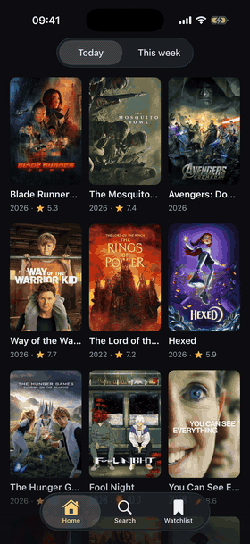
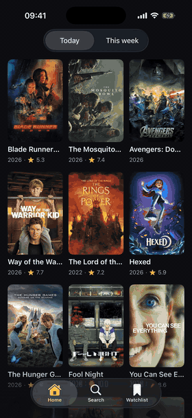
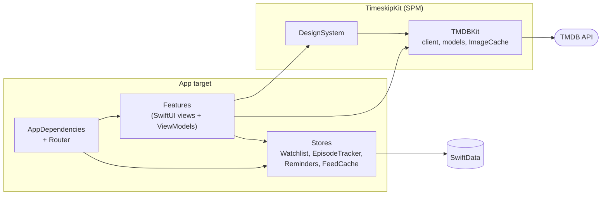

# Timeskip

[](https://github.com/baggioto/timeskip/actions/workflows/tests.yml)

A movie & TV tracker for iOS: browse what's trending, search, keep a watchlist and track the episodes you've watched.

Built in public as a senior-level iOS portfolio project: every feature is a deliberate exercise in modern iOS engineering (SwiftUI, Swift Concurrency, testing, modularization, CI) and every decision is documented.

Built with AI assistance (Claude Code). I own the product scope and the decisions, and the reasoning behind each choice is in the ADRs and the dev log.

> **Status:** v0.3. Trending, details, search, a persistent watchlist, episode tracking with "Up next" and new-episode reminders, in English and Portuguese. See the [roadmap](docs/ROADMAP.md) and the [dev log](docs/DEVLOG.md).

<p align="center">
  
  &nbsp;&nbsp;
  
</p>

## Features (v0.3)
- Trending movies & shows (today / this week) with infinite scroll and pull to refresh
- Title details: backdrop, genres, runtime, overview, cast, seasons
- Search as you type: debounced, the previous request is cancelled, recent searches remembered
- Watchlist saved on the device (SwiftData)
- Opens offline with the last trending page and says how old it is
- Episode tracking: mark episodes or whole seasons as watched, see progress, and an "Up next" list
- Reminder on the day a show's next episode airs (local notification)
- Deep links: `timeskip://title/tv/1399`
- English and Brazilian Portuguese, including TMDB data in the user's language
- VoiceOver labels and actions, Dynamic Type-friendly layout
- Loading, empty and error states on every screen, including offline and a missing token

## Engineering highlights
- **Typed errors end to end:** `async throws(APIError)` from the client to the ViewModels, so each screen switches over every failure case.
- **Actor-based image cache:** memory (LRU) + disk, concurrent requests for the same poster share one download, decoding happens off the main thread ([ADR 0006](docs/adr/0006-actor-image-cache.md)).
- **Pagination that survives TMDB:** trending pages shift while you scroll, so duplicates are filtered; a generation counter drops responses from an old tab or refresh.
- **Search cancellation through structured concurrency:** the debounce and the request run in one `Task`, so cancelling it also cancels the in-flight `URLSession` call.
- **Movie and show ids can collide on TMDB**, so titles are identified by `(mediaType, id)`.
- **Modular:** shared code in a local Swift package (`TMDBKit`, `DesignSystem`); design components can't see app state ([ADR 0007](docs/adr/0007-spm-modules.md)).
- **Persistence behind a store:** SwiftData for the watchlist, a JSON feed cache for offline launches; views never touch SwiftData ([ADR 0008](docs/adr/0008-persistence.md)).
- **On-device "Up next" and reminders:** no backend; notification taps go through the same deep-link router as URLs ([ADR 0009](docs/adr/0009-episode-tracking-and-reminders.md)).
- **Observability:** OSLog categories with request timing, and a MetricKit subscriber.
- **67 unit tests** (Swift Testing): client and decoding with a stubbed transport, ViewModels with a mock service, image cache, persistence, offline behavior, episode tracking, reminders, deep links. **4 UI tests** (XCUITest) on canned data.
- **Measured performance:** XCTest metrics for launch, scroll memory and each image-cache level; a memory hit costs ~17 µs vs ~7.6 ms from disk (simulator numbers, [docs/PERFORMANCE.md](docs/PERFORMANCE.md)).
- **CI:** swift-format lint + unit and UI tests on every push.

Later: iPad and landscape layouts, a home-screen widget, TestFlight. Full plan in [docs/ROADMAP.md](docs/ROADMAP.md).

## Architecture



MVVM per feature, dependencies injected from one composition root, shared code in a local Swift package, and no backend. More diagrams (layers, feed loading, concurrency, deep links) in [docs/ARCHITECTURE.md](docs/ARCHITECTURE.md).

## Tech stack
| Area | Choice |
|------|--------|
| UI | SwiftUI, `@Observable`, `NavigationStack` |
| Language | Swift 6, strict concurrency |
| Networking | `async`/`await` with `URLSession` |
| Images | Custom actor-based cache (memory + disk), see ADR 0006 |
| Persistence | SwiftData (watchlist), JSON in Caches (feed), see ADR 0008 |
| Modules | Local Swift package: `TMDBKit`, `DesignSystem` (ADR 0007) |
| Tests | Swift Testing (unit), XCUITest (UI) |
| CI | GitHub Actions: swift-format lint, unit and UI tests on every push |
| Data | [TMDB API](https://developer.themoviedb.org/) |

Minimum target: iOS 18 ([ADR 0005](docs/adr/0005-ios-18-and-xcodegen.md)). Project generated with XcodeGen.

## Documentation
| Doc | What's in it |
|-----|--------------|
| [docs/ARCHITECTURE.md](docs/ARCHITECTURE.md) | Module diagram, feed loading sequence, concurrency model, deep links |
| [docs/PRODUCT.md](docs/PRODUCT.md) | Problem, users, MVP scope, screens, what's out of scope |
| [docs/ROADMAP.md](docs/ROADMAP.md) | Milestones and the engineering checklist |
| [docs/PERFORMANCE.md](docs/PERFORMANCE.md) | Launch, scroll and image-cache measurements, and how to rerun them |
| [docs/DEVLOG.md](docs/DEVLOG.md) | Dated log of every work session |
| [docs/adr/](docs/adr/) | Architecture Decision Records |
| [Figma: MVP v0.1 screens](https://www.figma.com/design/XDV0KDQZaAJM0Gkda3pgAT) | Screen mockups, color variables and base components |

## Getting started
Requirements: Xcode 26+, [XcodeGen](https://github.com/yonaskolb/XcodeGen) (`brew install xcodegen`), a free [TMDB](https://www.themoviedb.org/settings/api) API Read Access Token.

```bash
cp Config/Secrets.example.xcconfig Config/Secrets.xcconfig   # then paste your token
xcodegen                                                     # generates Timeskip.xcodeproj
open Timeskip.xcodeproj
```

`Secrets.xcconfig` is git-ignored ([ADR 0004](docs/adr/0004-secrets-out-of-git.md)).

## Project structure
```
Timeskip/
  App/            entry point, composition root (AppDependencies), tabs
  Core/           config, feed cache
  Features/       Trending, Details, Search, Watchlist, About (view + ViewModel per feature)
Packages/TimeskipKit/
  TMDBKit/        models, TMDB client, DTOs, errors, image cache
  DesignSystem/   color tokens mirrored from Figma, shared components, RemoteImage
TimeskipTests/    Swift Testing, mocks and JSON fixtures
TimeskipUITests/  XCUITest smoke tests (run with -ui-testing)
Config/           xcconfig files (secrets stay local)
```

## Attribution
<!-- TMDB requires this notice and their logo in the app's About screen -->
This product uses the TMDB API but is not endorsed or certified by TMDB.
