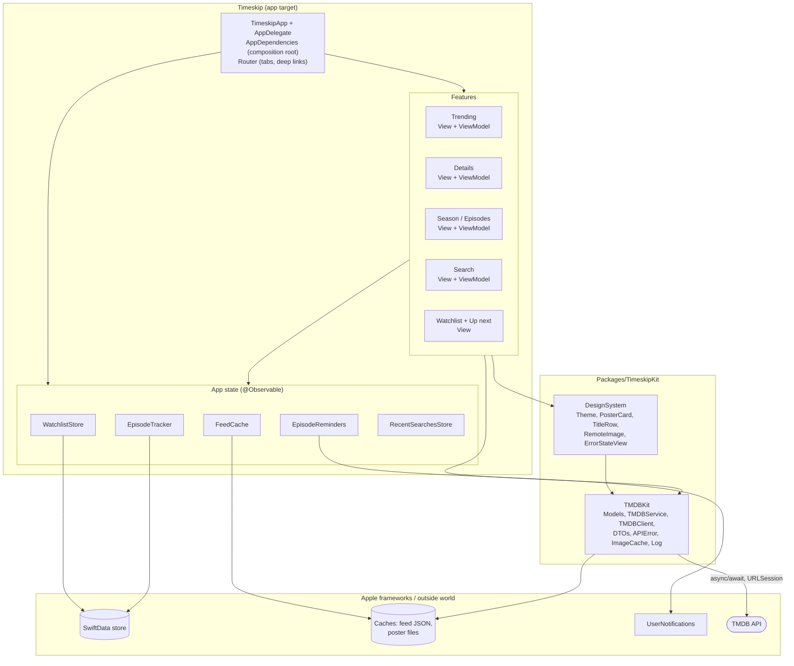
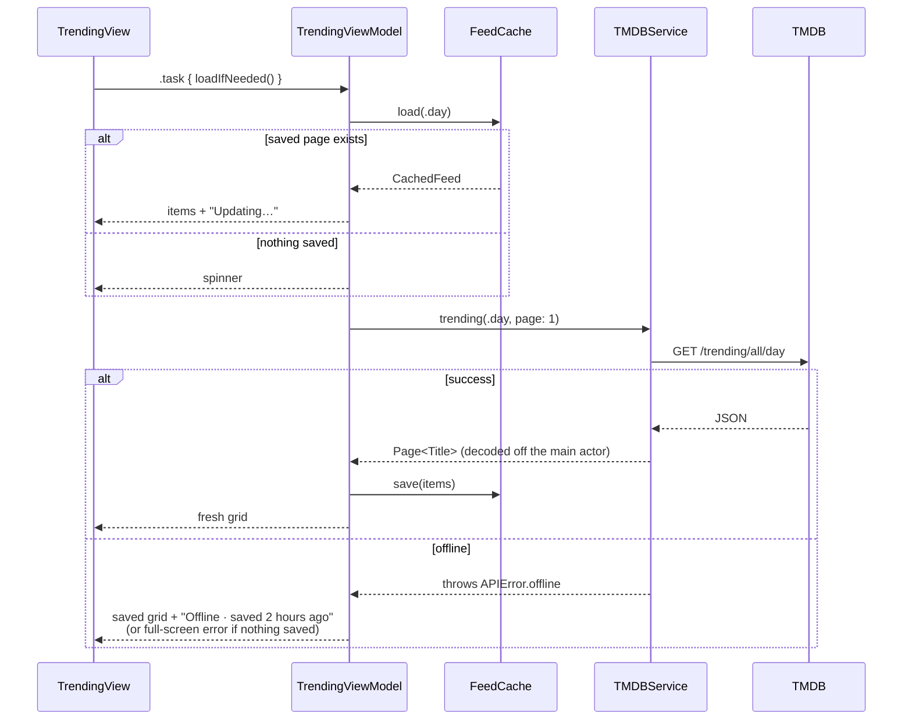

# Architecture

Timeskip is a SwiftUI app with MVVM per feature, a composition root that wires dependencies, and shared code in a local Swift package. There is no backend: TMDB is the only remote service, and everything the user owns (watchlist, watched episodes, reminders) lives on the device.

## Modules and layers

- **Features** depend on protocols (`TMDBService`, `FeedCaching`, `NotificationScheduling`) handed in by `AppDependencies`, so tests and previews swap in fakes.
- **DesignSystem** knows TMDB models but never app state: a poster card is told `isSaved`, it doesn't read the watchlist ([ADR 0007](adr/0007-spm-modules.md)).
- **Views never touch SwiftData.** They talk to `WatchlistStore` and `EpisodeTracker`, which own a `ModelContext` each on one shared store ([ADR 0008](adr/0008-persistence.md)).

## Loading the trending feed

## Concurrency

- Swift 6 language mode with **`MainActor` as the default isolation**: views, ViewModels and stores run on the main actor without annotations.
- **Background work is explicit:** JSON decoding and image decoding are `@concurrent`; `ImageCache` is an `actor` that dedupes concurrent downloads ([ADR 0006](adr/0006-actor-image-cache.md)); model types are `nonisolated` and `Sendable`.
- **Cancellation is structured:** search runs its debounce and request in one `Task`, cancelled on the next keystroke; `.task(id:)` cancels image loads for cells that scroll away.

## Deep links and notifications

`timeskip://title/{movie|tv}/{id}` → `Router.open(_:)` selects the Home tab and pushes the title. A tapped reminder carries the same URL in `userInfo`, and `AppDelegate` opens it, so both entry points share one code path ([ADR 0009](adr/0009-episode-tracking-and-reminders.md)).
