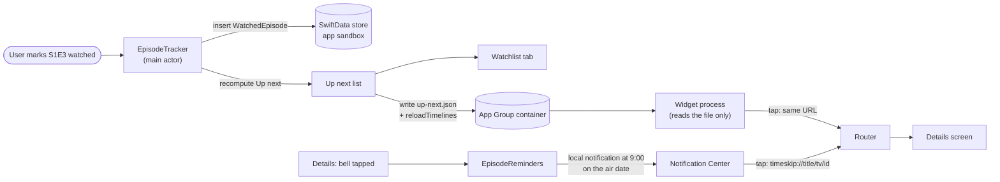

# Timeskip design doc

- Status: Implemented (v0.3)
- Last updated: 2026-11-27
- Related: [PRODUCT.md](PRODUCT.md) (what and why), [ARCHITECTURE.md](ARCHITECTURE.md) (module diagram, feed sequence), [ADRs](adr/) (one decision each), [PERFORMANCE.md](PERFORMANCE.md) (measurements)

This is the one document to read first. It describes the whole system end to end, the requirements it was built against, the alternatives that were rejected and why, and what can go wrong. Details live in the linked docs; this one connects them.

## 1. Context
People who follow several shows at once lose track of where they are ("what episode was I on?"), and recommendations get lost in chats. Timeskip is an iOS app to browse movies and TV, keep a watchlist, track watched episodes, see what's "Up next" and get a reminder when a new episode airs.

It's a portfolio project, built to show how a senior iOS engineer designs a small but complete app: real data, offline behavior, persistence, background work, a widget, tests, CI and documented decisions. It's built with AI assistance, and every decision is written down so it can be reviewed.

## 2. Goals and non-goals
**Goals**
- Browse trending titles, search, see details and seasons, using real TMDB data.
- Keep a watchlist and watched episodes that survive relaunches, and compute "Up next" without a network.
- Stay useful offline: show the last feed and everything the user saved.
- Remind the user on the day the next episode of a tracked show airs.
- Smooth on an average phone: no visible hitches while scrolling, first frame well under a second.
- English and Portuguese, VoiceOver and Dynamic Type from the start.
- Every decision reviewable: ADRs, a dev log, tests in CI.

**Non-goals** (on purpose, to keep it finishable; see [PRODUCT.md](PRODUCT.md))
- Accounts, a backend, or sync between devices.
- Playback or streaming links.
- Social features (reviews, friends, sharing lists).
- Android. (The architecture would carry over, the code wouldn't.)

## 3. Requirements
**Functional**

| # | Requirement | Where |
|---|-------------|-------|
| F1 | Trending feed (day/week), infinite scroll, pull to refresh | `Features/Trending` |
| F2 | Search as you type, previous request cancelled, recent searches | `Features/Search` |
| F3 | Details with cast, seasons for shows, add to watchlist | `Features/Details` |
| F4 | Mark episodes or whole seasons as watched; progress per season | `Features/Episodes` |
| F5 | "Up next": the next unwatched episode for each tracked show | `EpisodeTracker` |
| F6 | Reminder on the air date of the next episode | `Features/Reminders` |
| F7 | Home-screen and lock-screen widget with "Up next" | `TimeskipWidget` |
| F8 | Deep links `timeskip://title/{movie\|tv}/{id}` | `Router` |

**Non-functional**

| # | Requirement | Target | Measured (see [PERFORMANCE.md](PERFORMANCE.md)) |
|---|-------------|--------|----------|
| N1 | Scrolling | No hitches on a 60 Hz phone | iPhone 13: 0 hitches, 58.6 fps |
| N2 | Launch | First frame < 1 s on an average phone, app startup code < 50 ms | iPhone 13 Release: ~0.67 s; app code ~13 ms |
| N3 | Memory | No growth while scrolling a long feed | 32.6 MB peak, ~0.2 MB per fling |
| N4 | Offline | Every tab renders without a network | Feed from cache; watchlist, Up next, widget from local data |
| N5 | Correctness under concurrency | No data races | Swift 6 language mode, complete strict concurrency checking |
| N6 | Privacy | No user data leaves the device | No analytics SDK, no backend; only TMDB requests |
| N7 | Accessibility | Usable with VoiceOver and large text | First pass done; device audit open |

**Constraints**
- iOS 18+ (`@Observable`, the new `Tab` API) ([ADR 0005](adr/0005-ios-18-and-xcodegen.md)).
- No third-party dependencies in the app: networking, image caching and persistence use Apple frameworks only.
- TMDB terms: non-commercial use, attribution in the About screen ([ADR 0002](adr/0002-tmdb-as-data-source.md)).
- Free Apple developer account for now: no TestFlight, and device builds can't carry the App Group from the command line (see §9).

## 4. High-level design
SwiftUI, MVVM per feature, a composition root (`AppDependencies`) that builds every dependency once and hands protocols to the features. Shared code lives in a local Swift package with three libraries:

- **TMDBKit:** models, `TMDBService` + `TMDBClient`, DTOs, `APIError`, `ImageCache`, logging. No SwiftUI.
- **DesignSystem:** theme tokens and reusable views. Knows TMDB models, never app state.
- **AppGroupKit:** the small, Foundation-only snapshot the app and the widget share.

The module diagram and the feed-loading sequence are in [ARCHITECTURE.md](ARCHITECTURE.md). This is how the pieces around "Up next" connect, since that's the part with the most moving parts:

Two entry points (widget tap, notification tap) and URLs all go through one `Router`, so there's one code path to test.

## 5. Data
**Remote: TMDB v3**, four endpoints, all `GET`, with a read-access token and the user's language (`en-US` or `pt-BR`):

| Endpoint | Used for | Notes |
|----------|----------|-------|
| `/trending/all/{day\|week}?page=` | Feed | 20 titles a page; next page requested 6 items before the end |
| `/search/multi?query=&page=` | Search | 350 ms debounce, `include_adult=false`, previous task cancelled |
| `/{movie\|tv}/{id}?append_to_response=credits` | Details | Cast in the same round trip |
| `/tv/{id}/season/{n}` | Episodes | Air dates feed "Up next" and reminders |

Requests time out after 15 s. Responses are decoded off the main actor into `Sendable` models.

**Local**

| Data | Storage | Why there ([ADR 0008](adr/0008-persistence.md), [0009](adr/0009-episode-tracking-and-reminders.md)) |
|------|---------|-----|
| `WatchlistEntry` (unique `movie-27205`) | SwiftData | User data; must survive relaunches; queried and sorted |
| `WatchedEpisode` (unique `showID-sSeE`) | SwiftData | Same store, so one container and one migration story |
| `TrackedShow` (show snapshot + episode count per season) | SwiftData | Lets "Up next" be computed with no network call |
| Last first page of each trending window | JSON in Caches | Disposable; the system may purge it, and that's fine |
| Posters | Memory (150, LRU) + files in Caches | Re-downloadable ([ADR 0006](adr/0006-actor-image-cache.md)) |
| `up-next.json` | App Group container | The only thing the widget can read ([ADR 0010](adr/0010-up-next-widget.md)) |
| Recent searches | `UserDefaults` | Tiny list of strings |

Rows store **snapshots** of what the UI needs (name, poster path, rating), not just IDs. The Watchlist tab and the widget render without TMDB. The trade-off is that a renamed title or new poster isn't picked up until the user opens it again, which is acceptable for this data.

## 6. Key flows
- **Feed:** show the cached page at once with "Updating…", fetch page 1, replace and save. Offline: keep the cached page with "Offline · saved 2 hours ago", or a full-screen error with retry if nothing is cached. Pagination appends and skips duplicates (TMDB's trending list shifts between requests). Sequence diagram in [ARCHITECTURE.md](ARCHITECTURE.md).
- **Search:** each keystroke cancels one `Task` that holds both the debounce and the request, so a slow response for "brea" can never overwrite the results for "breaking".
- **Up next:** for each tracked show, the first unwatched episode after the furthest one watched; specials (season 0) don't count. Computed on device whenever watched episodes change.
- **Reminders:** scheduled when the user taps the bell, for 9:00 local time on TMDB's `next_episode_to_air` date. Permission is asked at that moment, not at launch.
- **Widget:** the app writes the snapshot and asks WidgetKit to reload; the widget never opens SwiftData, so the two processes never fight over the store.

## 7. Concurrency
Swift 6 language mode with `MainActor` as the default isolation: views, ViewModels and stores are main-actor without annotations. Background work is opted into explicitly (`@concurrent` JSON and image decoding). `ImageCache` is an `actor` that also dedupes concurrent requests for the same URL. Cancellation is structured (`.task(id:)` for cells, one `Task` per search). The compiler checks all of this (Swift 6 language mode, complete strict concurrency checking), so a data race is a build error rather than a crash in production. Details in [ARCHITECTURE.md](ARCHITECTURE.md#concurrency) and [ADR 0003](adr/0003-swiftui-and-swift-6.md).

## 8. Alternatives considered
| Decision | Chosen | Rejected, and why |
|----------|--------|-------------------|
| Where user data lives | On device only | **A backend with accounts:** sync across devices, but needs auth, a server, privacy policy and ops, and the product works without it. Sketch of how sync would be added in §13. |
| UI framework | SwiftUI | **UIKit:** more control and the author's long background, but modern roles expect SwiftUI, and a new app has no legacy to protect ([ADR 0003](adr/0003-swiftui-and-swift-6.md)). |
| Architecture | MVVM + composition root | **TCA:** strong testing story, but a large dependency and learning curve for five screens. **VIPER:** too much ceremony for SwiftUI. |
| Persistence | SwiftData | **Core Data:** mature, but more boilerplate for the same result on iOS 18+. **GRDB/SQLite:** full control, but a dependency and hand-written migrations. **JSON files for everything:** fine for the feed cache, poor for queries and uniqueness. |
| Images | Custom actor cache | **AsyncImage:** no cache, re-downloads and decodes on the main thread. **Kingfisher/Nuke:** excellent, but a dependency for something this central, and the concurrency design is part of what's being shown ([ADR 0006](adr/0006-actor-image-cache.md)). |
| Widget data | JSON snapshot in the App Group | **SwiftData store in the App Group, opened by both processes:** possible, but two processes writing one store invites conflicts, and the widget only needs a few fields ([ADR 0010](adr/0010-up-next-widget.md)). |
| New-episode alerts | Local notifications | **Push from a server:** works even if the user never opens the app, and catches schedule changes, but needs a backend (non-goal). |
| Modules | One package, 3 libraries; features in the app | **One module per feature:** stronger boundaries, but more `public` API and setup than five screens justify ([ADR 0007](adr/0007-spm-modules.md)). |
| Project file | XcodeGen | **Checked-in `.xcodeproj`:** no tool needed, but merge conflicts and unreadable diffs ([ADR 0005](adr/0005-ios-18-and-xcodegen.md)). |

## 9. Failure modes
| What fails | What the user sees | How |
|------------|--------------------|-----|
| No network | Cached feed with "Offline · saved …"; saved data everywhere else | `APIError.offline`, `FeedCache` |
| TMDB returns 401 | "TMDB rejected the token (401)" with retry | `APIError.http(401)` |
| TMDB rate limit (429) | Error with retry; nothing retries automatically | `APIError.http(429)`. TMDB's limits are generous for one user, so no backoff yet |
| Slow or stale responses | Never shown over newer ones | Cancellation, page-1 replace, de-duplicated pages |
| Notification permission denied | A message to turn on notifications in Settings | Permission requested when the bell is tapped; `.denied` outcome |
| Air date moves after scheduling | Reminder fires on the old date | Known limitation: the reminder keeps its date until the user turns it off and on again. Background refresh (§13) or a server push (§8) would fix it |
| App Group missing (e.g. free-account device builds) | Widget shows its empty state; the app works normally | `AppGroup.containerURL` is optional; the snapshot write is skipped |
| Caches purged by the system | Feed and posters load from the network again | Both are disposable by design |
| SwiftData schema change | — | v1 schema today; lightweight migration expected for additive changes. A versioned schema is needed before the first breaking change |

## 10. Security and privacy
- **No user data leaves the device.** No accounts, analytics or third-party SDKs. The only network traffic is TMDB requests (titles, search terms) over HTTPS.
- **The TMDB token** stays out of git (`Secrets.xcconfig`, [ADR 0004](adr/0004-secrets-out-of-git.md)), but it's injected into `Info.plist`, so it's inside the built app and can be extracted from the binary. That's acceptable here: it's a free, **read-only** token for public data. A commercial app would put a thin proxy in front of TMDB to hold the token, add caching and enforce limits.
- **Debug-only code stays out of Release:** canned test data and previews are behind `#if DEBUG`, and CI builds the Release configuration so a leak breaks the build.
- `include_adult=false` on search.

## 11. Observability
- **OSLog** with categories `Network`, `Images`, `Persistence`, `Notifications`, `Metrics`: visible in Console.app, no third-party service.
- **MetricKit** subscriber logs daily launch, hang and memory metrics and diagnostics from real use.
- **Signposts / XCTest metrics** for launch and scrolling ([PERFORMANCE.md](PERFORMANCE.md)).

There's no remote crash reporting, on purpose (N6). A shipped app would add one (e.g. Sentry or Crashlytics) with a privacy review.

## 12. Testing and CI
- **Unit tests (Swift Testing), 71:** ViewModels against a fake `TMDBService` (pagination, de-duplication, error and empty states, cancellation), stores against an in-memory SwiftData container, "Up next" rules, `Router` links, the widget snapshot round trip, request building and query encoding, DTO decoding, and typed HTTP errors.
- **UI tests (XCUITest):** main flows with canned data (`-ui-testing`), including landscape and iPad. A recording test drives the app for the README GIFs.
- **Performance tests:** launch, scrolling and image cache; run on demand (`scripts/perf.sh`, or on a device), not in CI, because shared runners are too noisy.
- **CI (GitHub Actions) on every push:** `swift-format lint --strict`, unit + UI tests on a simulator, and a Release build.
- **Not yet:** snapshot tests (waiting for a pinned simulator in CI), an Accessibility Inspector audit on a device.

## 13. Risks and open questions
- **TMDB is a single dependency.** If the API changes or the token is revoked, browsing stops; saved data keeps working. Mitigation: the `TMDBService` protocol isolates it, and the DTO layer absorbs format changes.
- **Snapshots go stale** (renamed shows, new seasons). Today they refresh when a title is opened. Open question: refresh tracked shows in a background task (`BGAppRefreshTask`) once a day?
- **Reminder accuracy** depends on the user opening the app after a schedule change. Background refresh would also fix this.
- **Sync, if it's ever needed:** the cleanest path is CloudKit through SwiftData's built-in support, which keeps "no backend of our own". It requires the paid account, every model property optional or defaulted, and no `.unique` constraints, so the unique keys would move into app logic. That's a real migration, which is why it's not done speculatively.
- **Widget on a device** needs the App Group in the provisioning profile; verified on the simulator only so far.

## 14. Release
v1.0 = TestFlight once the paid developer account is in place (Fastlane lane for build and upload), plus the open accessibility audit. Milestones and the checklist are in [ROADMAP.md](ROADMAP.md).
